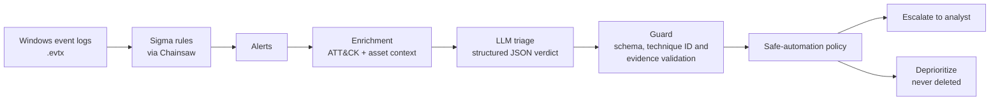

<!--
HOW TO USE THIS TEMPLATE
1. Replace every [PLACEHOLDER] with your real value (search for "[" to find them).
2. Only publish numbers you can reproduce by running the eval scripts.
3. Delete these HTML comments before publishing.
4. Replace YOUR-USERNAME with your GitHub username.
-->

# triageforge

**LLM-assisted SOC alert triage: Sigma detections enriched with MITRE ATT&CK context, with a measured evaluation harness and prompt-injection defenses.**


> **Relevant for:** SOC Analyst · Detection Engineer · Security Automation (SOAR) · AI Security

<!-- Add a demo GIF or screenshot here: -->
<!--  -->

---

## The problem

Security operations teams receive far more alerts than analysts can investigate, and most are false positives or low value. That drives fatigue, missed threats, and burnout. Vendors now claim AI can fix this, but few show **evidence**: how accurate is it, where does it fail, and can an attacker manipulate it?

**triageforge** is a small, reproducible pipeline that answers those questions. Sigma rules do the detecting; an LLM helps triage each alert; and every decision is measured against labeled data and a no-LLM baseline.

> **Important:** the LLM does not detect threats and never takes action. It is decision support. A human stays in the loop.

---

## How it works



<!-- Optionally replace or supplement with docs/architecture.png -->

1. **Detect:** Sigma rules are applied to Windows event logs using Chainsaw, producing alerts.
2. **Enrich:** each alert is mapped to MITRE ATT&CK technique and tactic data, plus asset criticality and frequency context.
3. **Triage:** an LLM returns a structured verdict (verdict, confidence, technique, severity, cited evidence, recommended actions).
4. **Guard:** outputs are validated against a strict schema; technique IDs must exist in ATT&CK; cited evidence must appear in the alert.
5. **Policy:** a safe-automation policy decides whether an alert is escalated to a human or safely deprioritized.

---

## Results

<!-- Fill in from your test split ONLY. Include dataset size and date. -->

**Dataset:** [N] labeled alerts ([TP] true positives, [FP] false positives) across [T] ATT&CK techniques. Metrics below are from the held-out **test split** ([N_test] alerts). Run date: [DATE]. Sigma rules commit: `[COMMIT]`. ATT&CK version: [VERSION].

| System | Precision | Recall | Queue reduction | Missed attacks | Cost / 100 alerts | Median latency |
|---|---|---|---|---|---|---|
| Baseline (Sigma level ≥ medium) | [ ] | [ ] | [ ] | [ ] | $0 | n/a |
| Naive LLM (no enrichment, no guards) | [ ] | [ ] | [ ] | [ ] | [ ] | [ ] |
| **triageforge (full pipeline), [API model]** | [ ] | [ ] | [ ] | [ ] | [ ] | [ ] |
| **triageforge (full pipeline), [local model]** | [ ] | [ ] | [ ] | [ ] | $0 | [ ] |


**Key takeaways**
- [One sentence: e.g. "The full pipeline reduced the review queue by X% while keeping recall at Y%."]
- [One sentence about the model comparison tradeoff.]
- [One sentence about the most surprising finding.]

**Technique ID hallucination rate:** [X]% before validation, [0]% after.
**Estimated analyst time saved:** [N] minutes per 100 alerts (*assumption: [M] minutes per Tier-1 review; estimate, not measured*).

See [`eval/failure_analysis.md`](eval/failure_analysis.md) for a detailed breakdown of where the system was wrong and why.

---

## Security of the AI itself

Log data is attacker-controlled, so alert fields are treated as **untrusted input** to the LLM. The pipeline applies layered defenses:

1. **Input handling:** fields are sanitized, truncated, and delimited inside `<alert_data>` tags; the model is instructed to treat contents as data, never instructions.
2. **Output validation:** strict Pydantic schema, ATT&CK ID check, and a check that cited evidence exists in the alert.
3. **Policy backstop:** even if the model is manipulated toward "benign", high-severity rules and critical assets are always escalated.

**Injection test results** ([N] adversarial cases):

| Defense layer | Cases caught |
|---|---|
| Model resisted on its own | [ ] / [N] |
| Caught by output validation | [ ] / [N] |
| Caught by policy backstop | [ ] / [N] |
| **Got through** | [ ] / [N] |

Details and threat model: [`docs/threat_model.md`](docs/threat_model.md). The threat model references the OWASP Top 10 for LLM Applications (prompt injection, insecure output handling, excessive agency, overreliance).

---

## Quickstart

**Prerequisites:** Python 3.11+, Git. Optional: [Ollama](https://ollama.com) for a free local model, or an API key.

```powershell
git clone https://github.com/YOUR-USERNAME/triageforge.git
cd triageforge
python -m venv .venv
.\.venv\Scripts\Activate.ps1        # macOS/Linux: source .venv/bin/activate
pip install -r requirements.txt
```

**Run the demo (no API key needed, uses bundled sample alerts and a mock model):**

```powershell
python -m triageforge run --input data/samples --provider mock
```

**Run with a local model:**

```powershell
ollama pull [MODEL_NAME]
python -m triageforge run --input data/samples --provider local
```

**Run with an API model:**

```powershell
copy .env.example .env      # then add your API key to .env
python -m triageforge run --input data/samples --provider claude
```

**Reproduce the evaluation:**

```powershell
.\run_eval.ps1
```

Results are written to `eval/results/`.

**Docker:**

```powershell
docker compose up
```

<!-- Time a fresh clone and state it: "Demo runs in under [N] minutes." -->

---

## Reproducing the full dataset

The bundled samples are a small sanitized subset. To rebuild the full dataset:

1. Download Chainsaw (WithSecureLabs/chainsaw releases) and clone SigmaHQ/sigma at commit `[COMMIT]`.
2. Clone `sbousseaden/EVTX-ATTACK-SAMPLES` and copy the listed files (see `data/sources.md`) into `data/raw/attack/`.
3. Add benign logs to `data/raw/benign/` ([describe: your Sysmon lab VM export / public baseline dataset]).
4. Run Chainsaw and the pipeline as described in [`docs/methodology.md`](docs/methodology.md).

Raw logs are not redistributed in this repository; see licenses under [Credits](#credits--data-sources).

---

## Project structure

```
triageforge/
├── README.md
├── docs/                 # architecture, methodology, threat model, lab setup
├── src/triageforge/
│   ├── models.py         # Alert and TriageVerdict schemas
│   ├── detect.py         # load and normalize Sigma alerts
│   ├── enrich.py         # ATT&CK and asset context
│   ├── triage.py         # LLM providers (API, local, mock)
│   ├── guard.py          # sanitization and output validation
│   ├── policy.py         # safe-automation policy
│   └── pipeline.py       # end-to-end run and CLI
├── data/
│   ├── samples/          # small sanitized demo set
│   ├── labels.csv        # ground-truth labels and dev/test split
│   └── injection_tests.json
├── eval/
│   ├── metrics.py
│   ├── results/
│   └── failure_analysis.md
├── tests/
├── Dockerfile
├── docker-compose.yml
└── .env.example
```

---

## Methodology

- **Ground truth:** alerts generated from known attack samples are labeled true positives (with technique); alerts generated from baseline activity are labeled false positives. [N] labels were manually spot-checked; [N] ambiguous alerts were corrected or removed.
- **Split:** [30]% development set (prompt tuning allowed) and [70]% held-out test set (final metrics only). Prompts were frozen before test evaluation.
- **Baselines:** rule severity alone, and a naive LLM without enrichment or guardrails.
- **Decision definition:** "escalate" counts as a positive prediction; recall on true positives is the priority metric because a missed attack is the worst outcome.
- **Reproducibility:** temperature 0, pinned dependencies, pinned Sigma commit; run configurations are recorded in `eval/results/runs.md`.

Full details: [`docs/methodology.md`](docs/methodology.md).

---

## Design decisions

- **Sigma detects, the LLM triages.** Detection stays deterministic and auditable; the LLM only helps prioritize.
- **Human in the loop.** The model can lower priority only in one narrow, high-confidence, low-risk case, and nothing is ever deleted or auto-remediated.
- **Structured output.** Strict schema and validation make results machine-readable and testable.
- **Cited evidence.** Every verdict must quote fields from the alert so an analyst can verify it quickly.
- **Local model option.** Keeps logs on-premises where data privacy matters, and removes API cost. Tradeoffs are shown in the results table.
- **Cost and latency tracking.** Reported per alert, because operational feasibility matters as much as accuracy.

---

## Limitations

<!-- Keep these honest. They increase credibility. Edit to match your project. -->

- The dataset is small ([N] alerts) and mostly lab-generated; production environments are noisier and more diverse.
- Labels come from dataset origin plus spot-checking, not a full manual review of every alert.
- Results depend on the specific models, prompts, and Sigma rules used, and may not generalize.
- Injection tests cover a limited set of attack patterns, not all possible ones.
- The system has not been evaluated with real analysts.

---

## Roadmap

- [ ] Detection tuning assistant: suggest Sigma filters from clusters of false positives, validated with `sigma check`
- [ ] Incident grouping and timeline summaries
- [ ] Analyst feedback loop to measure drift
- [ ] SIEM output format (Splunk/Elastic/Wazuh)
- [ ] Larger and more diverse labeled dataset

---

## Documentation

- [Methodology](docs/methodology.md)
- [Threat model](docs/threat_model.md)
- [Lab setup](docs/lab_setup.png)
- [Failure analysis](eval/failure_analysis.md)
- [Prompt versions](docs/prompt_v1.md)

---

## Credits & data sources

<!-- List every tool and dataset with its URL, license, and the date you downloaded it. -->

| Resource | Use | License | Accessed |
|---|---|---|---|
| [SigmaHQ/sigma](https://github.com/SigmaHQ/sigma) | Detection rules | [check repo] | [DATE] |
| [WithSecureLabs/chainsaw](https://github.com/WithSecureLabs/chainsaw) | Sigma matching on EVTX | [check repo] | [DATE] |
| [EVTX-ATTACK-SAMPLES](https://github.com/sbousseaden/EVTX-ATTACK-SAMPLES) | Attack log samples | [check repo] | [DATE] |
| [MITRE ATT&CK](https://attack.mitre.org) | Technique data (STIX) | [check terms] | [DATE] |
| [SwiftOnSecurity/sysmon-config](https://github.com/SwiftOnSecurity/sysmon-config) | Sysmon configuration | [check repo] | [DATE] |
| [Add others] | | | |

MITRE ATT&CK® is a registered trademark of The MITRE Corporation.

---

## Disclaimer

This is a research and portfolio project intended for education and defensive security. It is decision support, not an autonomous security product. Do not run attack simulations outside an isolated lab environment, and do not use real or sensitive logs with third-party APIs.

## License

MIT. See [LICENSE](LICENSE).

## Author

**[Your Name]** · [LinkedIn](https://linkedin.com/in/YOUR-PROFILE) · [Portfolio](https://YOUR-SITE) · [Blog post: What I learned measuring an LLM as a SOC triage assistant](https://YOUR-LINK)